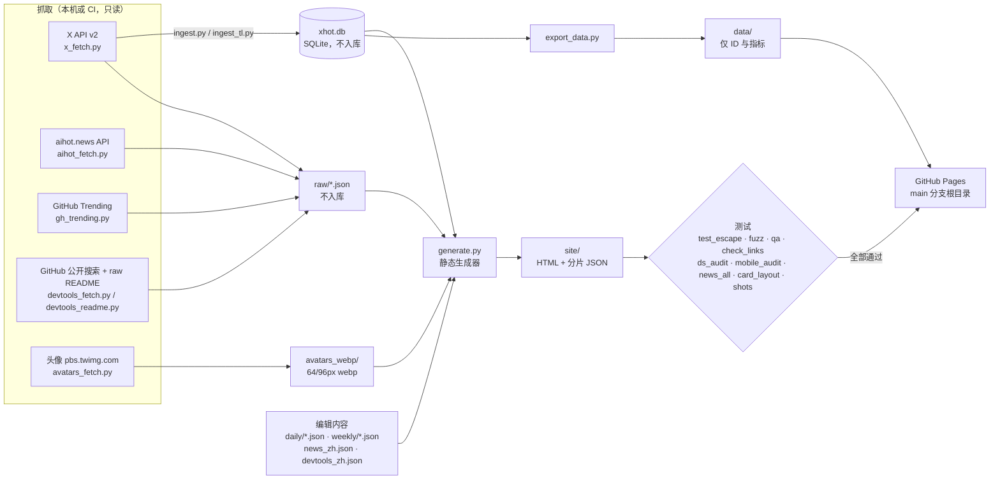

# XHOT · X 热点雷达

在线访问：<https://88daxiong.github.io/xhot/>　·　源码：[`src/`](src/)　·　参与重构：[`CONTRIBUTING.md`](CONTRIBUTING.md)　·　第三方许可：[`LICENSE-THIRD-PARTY.md`](LICENSE-THIRD-PARTY.md)

XHOT 是一个**纯静态**的 X（Twitter）热点简报：关注 AI、搞钱（创业 / 创作者经济）、个人成长三个领域约 130 个账号，外加 AI 资讯与 GitHub 上的 AI 开发工具。每天北京时间 08:00 完整刷新，14:00 / 20:00 / 次日 02:00 各做一次轻量刷新。目标是**每天 10 分钟看完重点**。

本 README 的目标是：**只看这一份文档，就能从零复刻整个站点**（用你自己的 X API 令牌和账号清单）。

## 目录
1. [页面地图](#页面地图)
2. [架构与数据流](#架构与数据流)
3. [数据来源、条款与配额](#数据来源条款与配额)
4. [源码结构 src/](#源码结构-src)
5. [环境准备](#环境准备)
6. [从零复刻：分步指南](#从零复刻分步指南)（含[环境变量](#环境变量)）
7. [定时刷新（cron / GitHub Actions）](#定时刷新cron--github-actions)
8. [设计系统](#设计系统)
9. [安全设计](#安全设计)
10. [合规与内容策略](#合规与内容策略)
11. [自定义：账号、领域、标签](#自定义账号领域标签)
12. [常见问题与排错](#常见问题与排错)
13. [English](#english)

想重构页面（前端 / 模板 / CSS / JS）？请先读 [贡献指南 CONTRIBUTING.md](CONTRIBUTING.md)。

## 页面地图

| 顶栏 | 页面 | 内容 |
|---|---|---|
| 今日 | `index.html`、`day/<日期>.html` | 三句话总结 → 必读 5–8 条（中文要点 + 可展开摘录）→ 今日 Top 30 → 话题涨跌 · 粉丝变化 · 资讯头条。每天一个永久链接 |
| 领域 | `d/ai.html` `d/money.html` `d/growth.html`、`d/all.html` | 一个领域一屏：本周重要帖子（15 个受控标签可筛）、必关注 10 人、领域话题、相关资讯；`all` 为全部归档（按天分片加载） |
| 人物 | `people.html`、`p/<handle>.html` | 本周 Top 30 人物要点 + 全部人物目录；个人页：简介、本周概览、发帖节奏、粉丝曲线、高光帖、时间线 |
| 资讯 | `news.html` | 两栏阅读器：AIHOT 中文资讯在前，X 新闻在后 |
| 趋势 | `trends.html` | X 话题讨论量 7 天涨跌 + GitHub 今日 AI / 开发工具趋势 |
| Agent | `agents.html` | AI 开发工具雷达：今日热门 / 本周热门 / 新出现 三个标签页，分类筛选，每页 9 张卡片（3/2/1 列），点卡片打开详情（README 纯文本摘要 + 中文一句话），数据懒加载自 `assets/agents.json` |
| — | 展开 | **每张帖子卡片都能展开**（今日 / 日报 / 领域 / 全部归档 / 人物页，含「再显示」载入的帖子与高光帖）：长摘录解除 6 行折叠，并显示详情（北京时间发布时间、点赞 / 转发 / 评论 / 引用 / 浏览 / 热度，及「全文请看原帖」说明）；必读卡片展开原帖摘录与译文切换（没有摘录时也能展开看数据）；Top30 与 Agent 列表行展开摘录、数据与动作区。**每个 GitHub 条目都能展开**：趋势页仓库行展开 README 摘要（有缓存时）、中文简介、描述、语言、★、今日 / 本周增星，以及 GitHub 与复制按钮（详情首次展开时才读 `assets/gh.json`）；Agent 卡片打开详情面板。⌘K 搜索结果是跳转链接，不是卡片 |
| — | 一键复制 | Agent 卡片与趋势页每个仓库有复制链接按钮；Agent 详情可复制仓库链接、`git clone https://github.com/<owner>/<repo>.git` 与仓库名；帖子卡片（今日 Top 30 / 领域 / 全部 / 人物页）复制帖子链接（放在动作区最后）；必读卡片不单独放链接复制按钮（「复制译文 / 复制摘录」已附带原帖链接，头部保持一行）；资讯正文复制原文链接 |
| — | `about.html` | 数据来源、AI 生成内容说明、撤下方式、免责声明（每页页脚有入口） |

全站：⌘K（或 `/`）搜索人物、标签、话题、日期、Agent 项目；浅色 / 深色 / 跟随系统；舒适 / 紧凑两档密度；**无统计脚本、无第三方请求**；已读 / 新增标记只存在浏览器 localStorage。

## 架构与数据流



生成器与托管无关：输出是纯静态目录，GitHub Pages、Cloudflare Pages、Netlify、对象存储 + CDN 均可。

### 前端性能设计（均有测试与预算）
- 每页只有 **一个内联脚本（主题预绘，带 sha256 的 CSP）和一个内联 `<style>`（按页裁剪，约 7KB gzip）**；JS 拆成 `core`（所有页）与 `news` / `feed`（按页），文件名带内容哈希、`defer`。
- 外链 CSS 在 Fast 3G 下会多一次往返（实测 FCP 约 +1s），所以 CSS 内联；若日后换到支持 HTTP/2 push / Early Hints 的主机，可改回外链。
- 数据分片（全部按需读取，首屏服务端渲染，无 JS 也能读正文）：
  - `feed/<日期>.json`：全部归档按天的摘录分片；`p/<handle>.json`：个人页时间线（「再显示」时读）。
  - `assets/nb/<k>.json`：资讯正文，每 10 条一片；点开某条时只读它所在的分片，鼠标悬停 / 触摸 / 键盘聚焦时预取。列表与首条正文直接渲染在 `news.html` 里。
  - `assets/pm.json`：精简作者表（账号、名字、头像、领域、标签表、日期），只给全部归档用；个人页的标签表直接内联在页面的 `#tw-meta` 里，不发请求。
  - `assets/search.json`：⌘K 完整索引（人物、要点、话题、Agent 项目），**只在 ⌘K 首次打开时**读取。
  - `assets/agents.json`：Agent 详情（README 摘要等），首次打开详情时读取；`assets/status.html`：数据健康表，点开才读。
  - `assets/gh.json`：趋势页 GitHub 条目详情（与 `agents.json` 同一份 README 摘要缓存），首次展开某个仓库时读取。
  - 文件名稳定，内容哈希只作 `?v=` 版本号写在引用处，所以轻量刷新只会改到真正有变化的文件。
- 头像：列表、卡片与人物网格统一用 64px 小图（`assets/av/<handle>.s.<hash>.webp`，约 0.6–1KB），只有个人页头部用 96px；首屏以下全部 `loading="lazy"`。
- 相对时间（x 小时前 / 今天 / 昨天）由前端补齐，**页面源码里不烘焙相对时间**，页面稳定、无数据变化就不改写文件；新 / 已读标记只存浏览器 localStorage。
- `<link rel="expect" blocking="render">` 等页头与工具条解析完再首次绘制，布局偏移（CLS）≈ 0；头像为 64px / 96px webp（约 0.7 / 1.5KB），首屏之外懒加载。
- 目标：首页首屏 ≤80KB gzip、LCP ≤1.0s（Fast 3G）、INP ≤100ms（CPU 4×）、CLS = 0；可用 `speed.py` 自测。

### 限制（诚实说明）
- GitHub Pages **不能设置响应头**：CSP 只能写在 `<meta>`，因此没有 `frame-ancestors`（页面可被 iframe 嵌套）、HSTS 不可控；`_headers` 文件只在 Cloudflare Pages / Netlify 等主机上生效。
- GitHub Pages 有软限制（站点 ≤1GB、月流量约 100GB、构建 10 分钟）；`github.io` 在中国大陆访问不稳定。当前规模远低于限制，若流量增长需要换托管（架构已与托管无关）。
- 每天约 150 个文件会变化（人物页的指标 / 摘录），仓库会持续增长；公开 `data/` 已去掉全文以控制体积和合规风险。
- 没有自定义 404 页（GitHub Pages 默认 404）；旧链接的跳转页不会保留 `#` 之后的参数。

## 数据来源、条款与配额

| 来源 | 用途 | 认证 | 条款 / 限制 | 脚本 |
|---|---|---|---|---|
| **X API v2**（只读公开数据） | 账号资料、用户时间线、话题计数、X 新闻（可选） | 你自己的 App Bearer Token | 遵守 [X Developer Agreement and Policy](https://developer.x.com/en/developer-terms/agreement-and-policy)；只公开 ID、指标与短摘录；配额取决于你的套餐 | `x_fetch.py` → `ingest.py` / `ingest_tl.py` |
| **aihot.news API** | AI 中文资讯与摘要 | 无 | 摘要内容 MIT 许可（声明见 `LICENSE-THIRD-PARTY.md`），原文版权归原站，只给链接 | `aihot_fetch.py` |
| **GitHub Trending** | 今日 / 本周趋势仓库（10 种语言） | 无 | 公开网页，低频抓取（每次刷新 ≤20 页） | `gh_trending.py`、`devtools_fetch.py` |
| **GitHub 公开搜索 API** | 新出现的 AI 工具、补全创建时间 | 无（未认证） | 搜索限 10 次/分钟（脚本每次间隔 7s，≤20 次）；核心 API 未认证 60 次/小时 | `devtools_fetch.py` |
| **raw.githubusercontent.com** | 仓库 README（只在完整刷新时取，ETag 缓存，≤100 个） | 无 | 不占核心 API 配额；只保留 ≤600 字纯文本摘要 | `devtools_readme.py` |
| **头像** | 作者标识 | 无 | 只接受 `pbs.twimg.com`，重新编码为 64 / 96px webp（约 0.7 / 1.5KB） | `avatars_fetch.py` |

### X API 调用与配额策略

| 步骤 | 端点 | 次数（约 130 账号、16 个话题时） |
|---|---|---|
| 账号资料 | `GET /2/users/by?usernames=`（每次 100 个） | 2 |
| 时间线（`since_id` 增量，排除回复与转推） | `GET /2/users/:id/tweets` | 约 131 |
| 话题计数（7 天按天） | `GET /2/tweets/counts/recent` | 16 |
| X 新闻（可选，取决于套餐） | `GET /2/news/search` | 3 |
| 新闻相关帖子 | `GET /2/tweets?ids=` | 3 |

- **完整刷新**（每天 1 次）约 155 次；**轻量刷新**（`x_fetch.py light`）只拉近 7 天最热的 `HOT_N`（默认 60）个账号的时间线，每次约 60 次。
- 全天合计约 340 次。`x_fetch.py` 每次调用至少间隔 1.1s，遇到 429 按 `x-rate-limit-reset` 等待后重试一次，并有本次调用上限 `MAX_CALLS`。
- 重要度的「作者常态」基线在完整刷新时更新；轻量刷新只加新帖、不改旧帖得分。aihot.news 与 GitHub 不占 X 配额。

## 源码结构 src/

```
src/
├─ x_fetch.py            # X API v2 抓取（full / light / 单步），令牌只读环境变量
├─ ingest.py             # 保存 API 响应到 raw/，users_* 写入 followers 表
├─ ingest_tl.py          # 时间线响应写入 tweets 表（按 id 去重，每账号保留最新 200 条）
├─ tl_plan.py            # 列出要拉取的时间线：handle user_id since_id
├─ news_posts_plan.py    # X 新闻相关帖子 id 批次
├─ aihot_fetch.py        # aihot.news 资讯
├─ gh_trending.py        # GitHub Trending（趋势页）
├─ devtools_fetch.py     # Agent 页：Trending + 公开搜索 → 分类、过滤
├─ devtools_readme.py    # Agent 页：README 抓取与纯文本清洗（≤600 字）
├─ avatars_fetch.py      # 头像下载与 webp 缓存
├─ check_deleted.py      # 可选：检查已展示帖子是否被删除，写入 takedown.txt
├─ demo_seed.py          # 离线演示数据（虚构），无需任何令牌即可跑通生成与测试
├─ generate.py           # 静态生成器 → site/
├─ xhot_data.py  langf.py  redact.py  reflow.py  daily_topics.py   # 生成器模块（数据读取 / 语言 / 脱敏 / 排版 / 话题）
├─ daily_draft.py        # 日报草稿（供编辑撰写 daily/*.json）
├─ export_data.py        # 导出 data/（仅 ID 与指标，含全文泄漏检查）
├─ app_core.js  app_feed.js  app_news.js  app_agents.js   # 前端脚本（构建时加内容哈希）
├─ style_base.css  style.css  style_ds.css  style_final.css  ds_tokens.json   # 样式与设计令牌
├─ ds_snap.py            # 构建时把 CSS 数值吸附到令牌刻度
├─ watchlist.json        # 当前站点使用的账号与话题配置（公开）
├─ watchlist.sample.json # 最小配置示例
├─ daily.sample.json  weekly.sample.json   # 日报 / 周要点格式示例
├─ news_zh.json  devtools_zh.json  takedown.txt   # 编辑内容：资讯中文、Agent 中文与隐藏、撤下清单
├─ .env.example          # 环境变量模板（复制为 .env，不入库）
├─ requirements.txt
├─ gzserve.py            # 本地预览：带 gzip 的静态服务器（模拟 GitHub Pages）
└─ 测试：test_escape.py fuzz.py qa.py check_links.py ds_audit.py mobile_audit.py card_layout.py expand.py shots.py
        viewports.py news_all.py speed.py speedtab.py audit.py prof.py prof2.py
```

### 数据库结构（`xhot.db`，SQLite，由 `ingest.py` / `ingest_tl.py` 自动建表）

```sql
CREATE TABLE followers(ts TEXT, username TEXT, user_id TEXT, name TEXT,
  followers INTEGER, following INTEGER, tweets INTEGER, PRIMARY KEY(ts, username));   -- 每次刷新一个快照
CREATE TABLE tweets(id TEXT PRIMARY KEY, author_id TEXT, created_at TEXT, text TEXT,
  likes INT, rts INT, replies INT, quotes INT, views INT, bm INT, url TEXT, lang TEXT, fetched_at TEXT);
```

`text` 只存在本机数据库里，**从不原样发布**：页面只用 ≤220 字（必读 ≤320 字）的摘录。

### raw/ 文件约定
`raw/<YYYYmmdd_HHMMSS>_<label>.json`，生成器按 label 取最新一份：`users_*`、`counts_<领域>__<话题名>`、`news_<领域>`、`news_posts_<领域>`、`aihot*`、`gh_trending`、`devtools`，以及 `agents_repos.json`、`readme_cache.json`。

## 环境准备

- **Python 3.10+**（开发与 CI 使用 3.13）；除 Pillow 外只用标准库。
- `pip install -r src/requirements.txt`：`Pillow==12.3.0`（头像转 webp，运行依赖）；`playwright==1.63.0`、`beautifulsoup4==4.15.0` **仅测试用**。
- 浏览器（仅测试）：`python3 -m playwright install chromium webkit`；Linux 上首次还需 `python3 -m playwright install-deps webkit`。
- 一个 X 开发者账号与 App（见下一节第 1 步）。不想申请也可以先用 `demo_seed.py` 离线体验。

### 环境变量

| 变量 | 用于 | 说明 |
|---|---|---|
| `X_BEARER_TOKEN` | `x_fetch.py`、`check_deleted.py` | 你的 X API Bearer Token，**只放环境变量 / CI Secrets** |
| `HOT_N` / `MAX_CALLS` / `X_NEWS` | `x_fetch.py` | 轻量刷新的热门账号数（默认 60）/ 本次 X 调用上限（默认 400）/ `0` 跳过 X 新闻 |
| `MAXREQ` | `devtools_readme.py` | README 抓取请求上限（默认 100） |
| `XHOT_QA_LIGHT` | `qa.py` | `1` = 轻量刷新模式（见测试一节），完整刷新不要设 |
| `XHOT_LIVE_LIKES` | `generate.py` | `1` = 必读的点赞数取库里最新值（轻量刷新用），否则用日报里记录的值 |
| `XHOT_WEEKLY` | `generate.py` | `1` = 输出本周 Top 30 人物的周要点草稿 |
| `XHOT_DRAFT` | `generate.py`（`daily_draft.py` 内部调用） | `YYYY-MM-DD` = 只打印当天候选后退出，不写站点 |
| `XHOT_DAILY_DIR` / `XHOT_WEEKLY_DIR` | `generate.py` | 日报 / 周要点目录（默认 `daily/`、`weekly/`；`test_escape.py` / `fuzz.py` 用它指向临时目录） |
| `XHOT_TEXT_MODE` | `generate.py` | 默认 `excerpt`（只发布短摘录），**请保持默认** |
| `XHOT_DB` | `export_data.py` | 数据库路径（默认 `xhot.db`） |
| `CHROME_PATH` | 浏览器测试 | 可选，系统 Chrome 路径；不设时用 playwright 自带浏览器 |
| `ONLY` / `SITE_DIR` | `shots.py` | 只截指定页面（逗号分隔）/ 站点目录（默认 `site`） |

## 从零复刻：分步指南

以下命令都在 `src/` 目录中执行。

### 0. 先离线跑通（可选，1 分钟）
```bash
cd src
python3 demo_seed.py          # 生成虚构的 xhot.db + raw/ + daily/weekly 示例（会覆盖当前 xhot.db）
python3 generate.py           # 输出 site/
python3 gzserve.py site 8840  # 浏览器打开 http://127.0.0.1:8840/
```
演示数据全部是虚构的（帖子、资讯、GitHub 仓库都是占位内容，链接指向 example.com 或不存在的 demo 仓库），但覆盖了所有页面，第 6 步的测试可以在演示数据上全部跑通。

### 1. 申请自己的 X Bearer Token
1. 在 [developer.x.com](https://developer.x.com/) 注册开发者账号，创建 Project 与 App。
2. 在 App 的 **Keys and tokens** 页生成 **Bearer Token**（只读应用级令牌即可）。
3. `cp .env.example .env`，把令牌填进 `X_BEARER_TOKEN=`，然后 `set -a; . ./.env; set +a`。`.env` 已被 `.gitignore` 排除。**永远不要把令牌写进代码、git config、remote URL 或提交历史。**

### 2. 配置账号清单（`watchlist.json`）
从 `watchlist.sample.json` 开始（或直接修改现有的 `watchlist.json`）。每个领域（`ai` / `money` / `growth`）：

| 键 | 含义 |
|---|---|
| `label` | 显示名 |
| `accounts` / `accounts_zh` | 英文 / 中文账号 handle（不带 @） |
| `groups` | 分组 `{组名: [handle…]}`，用于人物目录 |
| `keywords_en` / `keywords_zh` | 领域关键词（逗号分隔），用于领域归属与标签 |
| `trend_queries` | `{话题名: X 搜索语句}`，每个话题每次完整刷新 1 次计数调用 |
| `news_query` | X 新闻检索词（可选） |

受保护账号无法读取时间线，可加入 `tl_plan.py` 的 `SKIP`。

### 3. 抓取
```bash
python3 x_fetch.py full        # 账号资料 → 时间线 → 话题计数 → X 新闻（不支持则自动跳过；或 X_NEWS=0）
python3 aihot_fetch.py         # 资讯
python3 gh_trending.py         # 趋势页 GitHub
python3 devtools_fetch.py      # Agent 页（约 40 次请求，含 7s 搜索间隔，约 3–4 分钟）
python3 devtools_readme.py     # Agent 详情 README 摘要（只在完整刷新时跑）
python3 avatars_fetch.py       # 头像缓存
```
长任务请放后台并写日志，例如 `nohup python3 devtools_fetch.py > fetch.log 2>&1 &`。

### 4. 编辑内容（可选，但决定「今日」页质量）
- 日报 `daily/<YYYY-MM-DD>.json`：格式见 `daily.sample.json`（三句话、必读、要点、置顶 / 隐藏）。`python3 daily_draft.py > draft.json` 会按规则给出候选，再人工撰写或用你自己的 LLM 流程撰写。没有日报时页面按规则评分自动排序。
- 周要点 `weekly/<YYYY-Www>.json`：格式见 `weekly.sample.json`；`XHOT_WEEKLY=1 python3 generate.py` 输出周草稿。
- `news_zh.json`（X 新闻中文标题）、`devtools_zh.json`（Agent 项目中文一句话、改标签 `tag`、隐藏 `hide`）、`takedown.txt`（撤下的帖子 ID / handle，每行一个）。

### 5. 生成
```bash
python3 generate.py            # → site/
```
产物结构（即发布到 Pages 仓库根目录的内容）：
```
index.html news.html trends.html people.html agents.html about.html _headers
d/{ai,money,growth,all}.html      day/<YYYY-MM-DD>.html      p/<handle>.html + p/<handle>.json
feed/<YYYY-MM-DD>.json            # 全部归档按天分片
assets/core|feed|news|agents.<hash>.js
assets/nb/<k>.json                # 资讯正文分片（每 10 条）
assets/pm.json  assets/search.json  assets/agents.json  assets/gh.json  assets/status.html
assets/av/*.webp                  # 头像（64px .s 小图 + 96px）
hot.html accounts.html daily/<日期>.html   # 旧链接跳转页
```
注意：生成器不会删除 `site/` 里已不再生成的旧文件；同步到 Pages 仓库前先删掉上一版的 `assets/ feed/ d/ day/ daily/ p/` 再整体复制（Actions 示例已这样做）。

### 6. 测试（逐个运行，每个必须通过）
```bash
python3 test_escape.py                 # 转义 / XSS / safeUrl / 脱敏 / README 清洗回归，必须 ALL PASS
python3 fuzz.py 8                      # 8 组随机恶意字符串灌进日报 / 周要点所有字段
python3 qa.py                          # 内容 QA：重复、空区块、未翻译、领域错配（完整刷新用严格模式）
XHOT_QA_LIGHT=1 python3 qa.py          # 轻量刷新用：只放行 Top30 里带 EN 标记的「英文摘录」兜底（新入榜还没写中文一句话的英文帖）
python3 check_links.py site            # 站内链接与分片文件存在性
python3 gzserve.py site 8840 &         # 以下浏览器测试需要预览服务器（务必用 gzserve，不要用 http.server）
python3 ds_audit.py                    # 设计令牌一致性（字号 / 间距 / 圆角 / 字重）
python3 mobile_audit.py                # 手机 / 平板（Chromium + WebKit）：溢出、截断、字号下限、触控 44px、展开
python3 news_all.py                    # 逐条打开每条资讯（桌面窗格 + 手机就地展开）
python3 expand.py                      # 展开回归：每张帖子卡片 / 必读 / 列表行 / GitHub 条目都能展开并收起（含「再显示」与键盘），1440/1024/768/390 × Chromium+WebKit；另测 721–1100px 今日 / 日报页 CLS ≤ 0.001
python3 card_layout.py                 # 卡片头部回归：1440/1280/1024/768/390 × Chromium+WebKit，作者名 / handle 不换行、按钮互不重叠、今日页两栏占满宽度
python3 shots.py --all                 # 截图 + CSP / JS 错误 / 体积预算 / 功能断言
python3 viewports.py                   # 可选：12 种视口溢出检查
python3 speed.py http://127.0.0.1:8840/ http://127.0.0.1:8840/ > speed.json   # 可选：Fast 3G + CPU 4× 测速（两个参数为对比的两个站点，可相同）
```
浏览器测试默认使用 playwright 自带的 Chromium / WebKit；想用系统 Chrome 时设 `CHROME_PATH=/path/to/chrome`。所有浏览器测试的默认地址是 `http://127.0.0.1:8840/`，也可以把地址作为第一个参数传入。

### 7. 导出公开数据
```bash
python3 export_data.py         # data/：仅 ID 与指标，末尾做全文泄漏检查
```

### data/ 数据格式（不含任何推文全文）
- `data/accounts.json`：`{"accounts": [{handle, user_id, name, domains[], groups[], zh, followers, followers_ts, tweets_stored}]}`
- `data/followers_history.json`：每个账号的粉丝时间序列
- `data/tweets/<handle>.json`：`{"handle", "user_id", "tweets": [{id, created_at(UTC), lang, metrics{like, retweet, reply, quote, impression, bookmark}, url}]}`，**没有 text 字段**
- `data/daily/YYYY-MM-DD.json`：`{"date", "summary_zh":[3 句], "highlights":[{handle, name, post_id, url, likes, text_zh, excerpt, excerpt_zh?, tags[]}], "gists":{post_id: 一句话要点}, "pin":[], "hide":[], "topics_zh", "followers_zh", "changelog"}`
- `data/weekly/YYYY-Www.json`：`{"week", "exclude":[], "people":{handle:{"bullets":[…]}}}`

JSON 键排序固定、缩进 2。导出脚本在末尾做「全文泄漏检查」（出现 `text` / `text_orig*` 键或超过 400 字的字符串就失败）。

### 8. 部署到 GitHub Pages
1. 新建公开仓库，把 `site/` 的内容复制到仓库根目录，连同 `data/`、`src/`（不含 `xhot.db`、`raw/`、`.env`）。
2. 推送到 `main`。
3. 仓库 **Settings → Pages → Build and deployment → Source: Deploy from a branch**，选 `main` / `/ (root)`，保存。几分钟后访问 `https://<用户名>.github.io/<仓库名>/`。
4. 提交前检查暂存区（`git diff --cached`）：不得出现任何 GitHub 个人访问令牌、本机绝对路径、个人邮箱或任何密钥；有就不要提交。

## 定时刷新（cron / GitHub Actions）

时间均为北京时间（UTC+8）。完整刷新放在你的 X 配额重置之后。

**cron（自己的服务器）：**
```cron
0 8 * * *       cd /path/to/xhot/src && set -a && . ./.env && set +a && python3 x_fetch.py full  && python3 aihot_fetch.py && python3 gh_trending.py && python3 devtools_fetch.py && python3 devtools_readme.py && python3 avatars_fetch.py && python3 generate.py && python3 test_escape.py && python3 qa.py >> refresh.log 2>&1
0 14,20,2 * * * cd /path/to/xhot/src && set -a && . ./.env && set +a && python3 x_fetch.py light && python3 aihot_fetch.py && python3 generate.py && python3 test_escape.py && XHOT_QA_LIGHT=1 python3 qa.py >> refresh.log 2>&1
```
（生成通过后再把 `site/` 同步到 Pages 仓库并推送。）

**GitHub Actions 示例**（`.github/workflows/refresh.yml`）。令牌放在 **Settings → Secrets and variables → Actions** 的 `X_BEARER_TOKEN`，绝不写进文件；`xhot.db` 与 `raw/` 用 cache 在多次运行间保留：

```yaml
name: refresh
on:
  schedule:
    - cron: "0 0 * * *"        # 08:00 北京时间 完整刷新
    - cron: "0 6,12,18 * * *"  # 14:00 / 20:00 / 02:00 轻量刷新
  workflow_dispatch:
permissions:
  contents: write
concurrency: refresh
jobs:
  build:
    runs-on: ubuntu-latest
    timeout-minutes: 30
    steps:
      - uses: actions/checkout@v4
      - uses: actions/setup-python@v5
        with: { python-version: "3.13" }
      - run: pip install Pillow==12.3.0 beautifulsoup4==4.15.0
      - uses: actions/cache@v4
        with:
          path: |
            src/xhot.db
            src/raw
            src/avatars_webp
          key: xhot-data-${{ github.run_id }}
          restore-keys: xhot-data-
      - name: fetch and build
        working-directory: src
        env:
          X_BEARER_TOKEN: ${{ secrets.X_BEARER_TOKEN }}
        run: |
          if [ "${{ github.event.schedule }}" = "0 0 * * *" ] || [ "${{ github.event_name }}" = "workflow_dispatch" ]; then
            python3 x_fetch.py full && python3 gh_trending.py && python3 devtools_fetch.py && python3 devtools_readme.py && python3 avatars_fetch.py
          else
            python3 x_fetch.py light
          fi
          python3 aihot_fetch.py
          python3 generate.py
          if [ "${{ github.event.schedule }}" = "0 0 * * *" ] || [ "${{ github.event_name }}" = "workflow_dispatch" ]; then python3 qa.py; else XHOT_QA_LIGHT=1 python3 qa.py; fi
          python3 check_links.py site
          python3 export_data.py
      - name: publish
        run: |
          rm -rf assets feed d day daily p ./*.html   # 先删上一版生成物，避免旧分片残留
          cp -r src/site/. .
          git config user.name "${{ github.actor }}"
          git config user.email "${{ github.actor }}@users.noreply.github.com"
          git add -A ':!src/xhot.db' ':!src/raw' ':!src/site'
          git diff --cached --quiet || git commit -m "refresh $(date -u +%F_%H%M)"
          git push origin HEAD:main
```
浏览器测试（`test_escape.py` 的端到端部分、`mobile_audit.py`、`shots.py`）需要 `pip install playwright beautifulsoup4 && python3 -m playwright install --with-deps chromium webkit`，可放在单独的 job 里。

## 重要度、标签、人物榜

- **热度** = 赞 + 2×转推 + 3×引用 + 评论 + 收藏。
- **重要度（0–100，规则可复现）** = `6·ln(1+热度) + 10·clamp(ln((热度+20)/(作者最近 30 条热度中位数+20)), −1, 2.5)`：既看绝对热度，也看相对作者自己的常态，大号小号可比。榜单每人最多 2 条、文本去重、纯链接帖不进榜。**每天由编辑做最终复核**：必读挑选、置顶 / 隐藏、噪声过滤。
- **15 个受控标签**（关键词规则打标，可能有误差）：AI：模型 · 智能体 · 编程 · 开源 · 产品发布 · 研究 · 芯片算力 · 政策；搞钱：创业 · 创作者经济 · 融资 · 独立开发；成长：习惯 · 写作 · 职业。
- **本周 Top 30 人物** = 近 7 天前 3 条帖子重要度之和最高的 30 人（排除灌水账号），每周一由编辑写每人 1–2 条「本周要点」。
- **日窗口**：某日的日报覆盖「该日 09:00（北京时间）往前 25 小时」。

## 设计系统

令牌定义在 [`src/ds_tokens.json`](src/ds_tokens.json)，生成器（`ds_snap.py` 构建时吸附）和 `ds_audit.py` 共用：

| 令牌 | 取值 |
|---|---|
| 字号（px，以 rem 输出，随系统字号缩放） | cap 12 · sm 13 · md 14（手机 15）· lg 16（手机 17）· xl 20 · xxl 28 |
| 字重 | 400 · 500 · 600 · 700 |
| 间距（px） | 0 1 2 4 8 12 16 24 32 40 48 56 64（CSS 变量 `--s1`…） |
| 圆角（px） | 4 · 6 · 8 · 12 · 16 · 999（胶囊） |
| 顶栏高度 | 桌面 52 · 手机 56；页面左右内边距 桌面 24 · 手机 16 |
| 边框 / 阴影 | 只有一种 1px 边框（`--bd`）和一种卡片阴影（`--sh`） |

颜色（`style_base.css`，深色模式通过 `[data-theme=dark]` / `prefers-color-scheme` 覆盖）：

| 变量 | 浅色 | 深色 | 用途 |
|---|---|---|---|
| `--bg` | `#f6f5fb` | `#0f0c26` | 页面背景 |
| `--card` | `#fff` | `#1a1640` | 卡片 |
| `--bd` / `--bd2` | `#e6e4ef` / `#f0eef6` | `#2c2856` / `#221e48` | 边框 / 分隔 |
| `--tx` / `--tx2` | `#18181b` / `#3f3f46` | `#f4f4f5` / `#d4d4d8` | 正文 / 次要文字 |
| `--mu` | `#6b6880` | `#a5a3c9` | 元信息 |
| `--ac` / `--actx` | `#7c3aed` / `#6d28d9` | `#c084fc` / `#e9d5ff` | 强调色 / 强调文字 |
| `--up` / `--dn` | `#16a34a` / `#dc2626` | `#4ade80` / `#fb7185` | 涨 / 跌 |

组件规则：
- 共享组件都在 `style_ds.css`：页面容器、标题层级、卡片、列表行、标签、按钮、分段控件、标签页、分页、底部详情面板、手机整页阅读页。
- 所有对比度需达到 WCAG AA；彩色底上的选中态文字用深色（`#0f0c26`），不要用白字。
- 触控目标 ≥44px（手机）；阅读文字 ≥15px、次要 ≥13px、元信息 ≥12px（手机）。
- 展开 / 收起统一走 `app_core.js` 的 `xp()`：高度动画、`aria-expanded`、滚入视口、减少动效时直接切换。长帖正文默认折叠为 6 行并渐隐（`.pt.clp`）。所有帖子卡片都有「展开」（`app_core.js` 的 `pexp()`）：点击卡片空白处或按钮，解除折叠并展开详情 `.pxd`（由卡片的 `data-ts` / `data-m=赞,转,评论,引用,浏览,热度` 在首次展开时生成，只用 textContent）。`<details>` 行（Top30、Agent 列表）打开走原生开合再用 `xp()` 补动画，收起由 `xp()` 动画后关闭；趋势页 GitHub 行是 `button.grow`，展开区 `.gxd` 首次展开时读 `assets/gh.json` 填充。新增可展开的东西必须复用这几条路径，不要另写一套。
- 今日 / 日报页头日期栏在 ≥721px 保持一行（说明文字放不下时省略号），因为前端会把日期改写成「今天 · 10月21日」，换行会造成布局偏移。
- 复制按钮：图标按钮 `.cpy`（与 `.btn` 同边框、同圆角，桌面 32×28 / Agent 卡片 36×36，触屏与 ≤720px 为 44×44），纯 CSS mask 图标，成功后换成对勾并浮出 12px「已复制」提示（深色模式下为深底浅字的反色气泡）；Agent 详情里是带文字的 `.btn.cpb`，就地换成「已复制 ✓」。都带 `aria-label`，可用键盘 Enter / Space 触发，并通过 `aria-live` 读出「已复制」。
- 卡片头部（头像 + 作者名 + handle + 点赞 + 动作按钮）在桌面 / 平板上必须保持作者名与 handle 各自一行；空间不够时让点赞与按钮整体换到下一行，不要再往头部塞按钮。新增按钮放进卡片底部动作区（`.act`，复制图标排在最后）。
- 样式选择器要带页面作用域：通用类名（如 `.dgrid`）在多个页面复用，Agent 页网格写成 `.dtpan .dgrid`，否则会改坏今日页的两栏布局。
- Agent 卡片网格：>1000px 3 列，721–1000px 2 列，手机 1 列；每页 9 张。
- 改样式后必须跑 `ds_audit.py` 与 `mobile_audit.py`，不得有越界值。

## 安全设计

- **CSP**：每页 `<meta>` CSP，`script-src` 只允许本站与主题预绘脚本的 sha256，`connect-src 'self'`，`img-src 'self' data:`，`object-src` / `frame-src` / `form-action` 全部禁用，无任何第三方源；另有 referrer meta。
- **转义**：所有文本先转义再渲染（服务端 `e()` 先脱敏再 HTML 转义，含译文、摘录、⌘K 结果、分片数据）；嵌入 HTML 的 JSON 额外转义 `<>&`、U+2028/2029；前端只用 `textContent` 插入外部数据（Agent 页详情面板也是），无 `eval` / `document.write` / `outerHTML`。
- **链接**：所有外链经 `safe_url()` / `safeUrl()`，只放行 `http(s)`，带 `rel="noopener noreferrer"`；指向内网 / 本机地址的链接不渲染为链接。
- **一键复制**：复制内容放在按钮的 `data-copy` 属性里，生成器端只接受 `safe_url()` 校验过的 http(s) 链接（已转义），Agent 详情里的仓库名先校验 `owner/repo` 格式再拼接；复制用 `navigator.clipboard`，不可用时（Safari / iOS 非安全上下文等）退回隐藏 textarea + `execCommand`。按钮在捕获阶段处理点击并阻止冒泡，不会触发卡片打开或展开。
- **头像白名单**：只接受 `pbs.twimg.com`，下载后用 Pillow 重新编码为 webp。
- **README 清洗**：Agent 详情只保留纯文本（去掉 HTML、图片、徽章、链接目标、代码块），≤600 字。
- **隐私脱敏**（`redact.py`）：简介与摘录中的邮箱、11 位手机号、微信号统一隐藏。
- **不发布全文**：公开仓库与站点里没有推文全文；`export_data.py` 末尾的泄漏检查发现 `text` 键或超长字符串就失败。
- **密钥**：令牌只放环境变量 / CI Secrets；`.env`、`xhot.db`、`raw/` 已被 `.gitignore` 排除。
- **撤下流程**：在本仓库开 Issue（附帖子链接或账号），维护者把 ID / handle 加入 `src/takedown.txt`，下次刷新即从页面与 `data/` 中移除；`check_deleted.py` 可批量发现已删除的帖子并自动加入。
- 回归：`test_escape.py`（必须 ALL PASS）与 `fuzz.py`。

## 合规与内容策略

- **仓库与站点只公开帖子 ID、互动指标、≤220 字（必读 ≤320 字）的短摘录、编辑撰写的中文要点 / 译文摘录，以及指向 X 的原帖链接**；不再公开推文全文（v14 的 `data/tweets/*.json` 与日报 `text_orig` 已停止公开）。要读全文请点「在 X 打开」。
- 英文帖的中文是**摘录的中文译文**（带「译」标记，仅供参考，以原文为准）。
- 资讯：AIHOT 的摘要 / 综述来自其公开 API（MIT 许可）；文章原文版权属于原站，本站只给链接。
- 推文内容版权归原作者；本项目只做摘录、索引与展示。

- 使用 X API 须遵守 [X Developer Agreement and Policy](https://developer.x.com/en/developer-terms/agreement-and-policy)：本项目只读取公开数据，**公开发布的只有帖子 ID、互动指标、短摘录和指向 X 的链接**；被删除或受保护的内容通过 `takedown.txt` 与 `check_deleted.py` 及时移除。
- 站内 `about.html` 说明数据来源、哪些内容是 AI 生成（中文要点 / 译文，带「译」标记）、撤下方式与免责声明。
- 本项目与 X Corp.、AIHOT、GitHub 无隶属关系；以上不构成法律意见。

## 自定义：账号、领域、标签

- **换账号**：改 `watchlist.json` 的 `accounts` / `accounts_zh` / `groups`，下次 `x_fetch.py full` 会自动拉资料与时间线；删掉的账号不再更新（历史数据留在本机库里）。
- **换话题**：改 `trend_queries`（每个话题每天 1 次计数调用，注意配额）。
- **改领域**：领域键决定 `d/<键>.html`。增删领域需同时修改 `generate.py` 中的 `DOMS`、导航与标签规则，并更新 `qa.py` 的领域检查。
- **改标签**：`generate.py` 中的标签规则表（形如 `('code','编程','ai', r'claude code|codex|…')`：键、显示名、所属领域、正则）。保持受控标签数量少而稳定。
- **Agent 页**：分类规则与屏蔽词在 `devtools_fetch.py` 的 `RULES` / `BLOCK`；中文一句话、改分类、隐藏在 `devtools_zh.json`。
- **改样式**：先改 `ds_tokens.json` 与 `style_ds.css`，再跑 `ds_audit.py`。

## 常见问题与排错

- **长任务被中断 / 终端卡住**：`devtools_fetch.py`（有 7s 搜索间隔）、`shots.py --all`、`mobile_audit.py` 都可能运行数分钟。用 `nohup … > x.log 2>&1 &` 放后台，逐步写日志，再查看日志，不要在前台长时间阻塞。
- **体积预算测试失败，但页面并不大**：预算按 **gzip 后**的传输体积计算。用 `python3 -m http.server` 预览不压缩，会误报；请用 `gzserve.py`。
- **Safari / iOS 上卡片文字压住按钮**：WebKit 在「纵向 flex 容器 + 自动高度」里对 `flex:1`（基准 0%）的子元素会算出过小的高度，文字溢出。正文用 `flex:1 0 auto; min-height:0`，长文本再配合行数折叠与展开；`mobile_audit.py` 会同时在 Chromium 与 WebKit 里检查。
- **平板宽度下顶栏换行压住内容**：721–1060px 时顶栏高度需为 `auto`（已在 `style_ds.css` 处理）。
- **429 Too Many Requests**：`x_fetch.py` 会按重置时间等待重试一次；仍失败就降低 `HOT_N` / 话题数，或调大刷新间隔。GitHub 搜索 403 / 429 通常是未认证搜索的 10 次/分钟限制。
- **X 新闻为空**：`/2/news/search` 取决于你的 API 套餐，不支持时设 `X_NEWS=0`，资讯页只显示 AIHOT。
- **`test_escape.py` 找不到 daily / weekly**：先放至少一份日报和周要点（`demo_seed.py` 会自动放示例）。
- **轻量刷新时 qa 报「Top30 一句话 无中文」**：新入榜的英文帖还没有中文一句话，轻量刷新应以 `XHOT_QA_LIGHT=1` 运行 qa（只放行带 EN 标记的英文摘录）；完整刷新时补写 `daily/<日期>.json` 的 `gists` 后用严格模式。
- **复制按钮没反应**：非 https / 非 localhost 页面里浏览器不提供 `navigator.clipboard`，会自动退回 textarea 方案；若仍失败按钮会显示「复制失败」。
- **浏览器测试报找不到 Chrome**：先 `python3 -m playwright install chromium webkit`，或设 `CHROME_PATH`。
- **改了样式后某个宽度下布局错乱**：先跑 `card_layout.py` 与 `mobile_audit.py`，它们覆盖 1440 / 1280 / 1024 / 768 / 390 与 Chromium、WebKit；1001–1100px 是最容易挤压的区间。
- **页面没变化**：生成器不烘焙相对时间，数据没变就不改写文件，这是有意的（减少提交噪声）。
- **字体或间距审计报越界**：新写的 CSS 数值没落在令牌刻度上，改用 `var(--s*)` / `var(--t-*)` / `var(--r*)`。

## English

Want to refactor the pages (front end / templates / CSS / JS)? See [CONTRIBUTING.md](CONTRIBUTING.md) (fork → `refactor/<topic>` → PR; demo data only, no tokens needed).

**XHOT** is a static briefing of hot posts on X across AI, making money and personal growth (~130 accounts), plus AI news and an AI developer-tools radar from GitHub. It is fully refreshed daily at 08:00 (Asia/Shanghai), with light refreshes at 14:00, 20:00 and 02:00. Pages: Today, Domains, People, News, Trends, Agent (GitHub AI tools: today / this week / new), plus ⌘K search. Repo cards, the detail view (URL, `git clone`, repo name), post cards and news items have one-click copy buttons.

**Replicate it:** `pip install -r src/requirements.txt`; run `cd src && python3 demo_seed.py && python3 generate.py && python3 gzserve.py site 8840` for an offline demo. For real data, create your own X developer App, put its Bearer Token in `.env` as `X_BEARER_TOKEN` (never commit it), edit `watchlist.json`, then run `x_fetch.py full`, `aihot_fetch.py`, `gh_trending.py`, `devtools_fetch.py`, `devtools_readme.py`, `avatars_fetch.py`, then `generate.py`. Run the tests one by one, export `data/` with `export_data.py`, and publish `site/` to GitHub Pages (Settings → Pages → Deploy from a branch → `main` / root). A GitHub Actions example is above. Light refreshes run `XHOT_QA_LIGHT=1 python3 qa.py`, which accepts English-excerpt fallbacks for new Top 30 entries; full refreshes run qa in strict mode. Environment variables are listed in the 环境变量 table. Browser tests use Playwright's bundled browsers unless `CHROME_PATH` is set. Every X post card and every GitHub item on the site is expandable through the shared expander in `app_core.js` (`pexp()` / `xp()`); trending-repo details are lazy-loaded from `assets/gh.json`. `expand.py` checks this at four widths in Chromium and WebKit.

The repo and site publish **only post IDs, metrics, short excerpts (≤220–320 characters), editor-written Chinese summaries and links back to X — never full post text**. They follow the X Developer Agreement. There are no analytics and no third-party requests. Pages use a strict meta CSP, escape everything, filter links through safeUrl and only accept avatars from `pbs.twimg.com`. To request a takedown, open an issue. Post content belongs to the original authors; AIHOT summaries are MIT-licensed.
